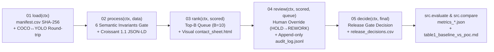

# Group Report — Day 06 Data Lab (Field-to-Release PoC)

> Điền đầy đủ, cụ thể, không viết chung chung. Mọi con số phải lấy từ file do script sinh ra
> (`reports/metrics_*.json`, `reports/table1_baseline_vs_poc.md`) — không gõ tay, không làm tròn mất đơn vị.

## 00 · Header

| Mục | Giá trị |
|---|---|
| Group ID | `G06` |
| Challenge | `T06` · Dataset Semantic Integrity & Provenance Gate |
| Thành viên + vai trò | 1. **Tran Quang Vinh** (`2A202603054`) — Lead / Integrator / Data & Provenance / Core Algorithm / QA & Metrics / Human Review & Report |
| Git URL | `https://github.com/gloryTran04/K5-Day06-L2-TranQuangVinh-2A202603054-DataGovernanceAndPrivacy` |
| Tag `demo-180m` (commit) | `demo-180m` |
| Tag `final-24h` (commit) | `final-24h` |
| Deadline (giờ VN) | `2026-11-15T15:00:00+07:00` |

---

## 01 · Problem statement

- **Ai bị ảnh hưởng / ai chịu hậu quả khi hệ thống sai?**
  - **Đội huấn luyện mô hình (ML/Perception Engineers) & người dùng cuối của hệ thống xe tự hành/ADAS:** Nếu một bản phát hành dữ liệu (`dataset release`) bị đảo nhãn giữa `car` và `pedestrian` (`class_swap`) hoặc dịch chuyển hộp giới hạn (`bbox_shift`) mà vẫn lọt qua cổng kiểm duyệt để đưa vào huấn luyện, mô hình thị giác máy tính sẽ học sai ngữ nghĩa đối tượng trên đường phố (nhận diện người đi bộ thành xe hơi hoặc định vị lệch vị trí vật cản), gây nguy cơ mất an toàn trực tiếp.
  - **Đội Vận hành Dữ liệu (Data Operations / Release Owner):** Nếu cổng kiểm duyệt quá cứng nhắc (chỉ so sánh mã băm SHA-256 hoặc kích thước file), mọi bản cập nhật hợp lệ có bổ sung thêm frame mới hoặc có sai số làm tròn số thực sub-pixel sẽ bị chặn nhầm (`False-block`), làm đình trệ toàn bộ đường ống phát hành dữ liệu từ vendor.
- **Điểm nghẽn cụ thể:**
  - Các công cụ kiểm tra truyền thống chỉ xác thực cú pháp JSON (`json.loads`), cấu trúc schema cơ bản của COCO (`images`, `annotations`, `categories`) và sự tồn tại của file ảnh trên đĩa. Chúng hoàn toàn mù trước **5 loại lỗi ngầm (silent semantic defects)** khi file JSON vẫn hợp lệ 100%:
    1. `stale_map`: Bản phát hành khai báo `label_map_version = lm-3` (5 lớp) nhưng phần `categories` lại đóng gói nhầm bản đồ nhãn cũ `lm-2` (4 lớp, thiếu lớp `5: truck`), khiến các bbox có `category_id = 5` trở thành nhãn mồ côi.
    2. `class_swap`: Đảo ngược ánh xạ ID $\leftrightarrow$ tên lớp trong `categories` (`1: pedestrian, 2: car` thay vì `1: car, 2: pedestrian`).
    3. `id_collision`: Trùng lặp khóa chính `annotation.id` giữa các hộp giới hạn khác nhau, gây ghi đè âm thầm khi nạp vào cơ sở dữ liệu huấn luyện.
    4. `dropped_frames`: Rơi mất hàng loạt frame ảnh của bản gốc `v1.0` làm đứt gãy chuỗi thời gian (`sequence_id` / `frame_index`).
    5. `bbox_shift`: Dịch chuyển tọa độ `[x, y, w, h]` có hệ thống (lệch $20\text{–}30\text{ px}$ trên hơn 200 đối tượng) do lỗi chuyển đổi hệ quy chiếu/tỷ lệ ảnh từ phía vendor.
- **Đầu vào → đầu ra:**
  - **Đầu vào:** Thư mục `fixtures/t06_release_gate/` gồm `manifest.csv` (66 files có SHA-256), bản phát hành gốc `releases/v1.0/` (`annotations.json`, `release_meta.json`, `classes.txt`, `yolo_labels/*.txt`), lịch sử ánh xạ nhãn `releases/label_maps.json` (`lm-2`, `lm-3`), 100 ảnh thumbnail `images/frame_000.jpg .. frame_099.jpg`, và 20 bản phát hành ứng viên `releases/candidates/r01 .. r20` được liệt kê trong `releases.csv`.
  - **Đầu ra:**
    - `out/poc/release_decisions.csv`: Bảng quyết định cho từng bản phát hành (`release_id, decision, root_cause, score, reason, suggested_action, slice, evidence_path`).
    - `out/poc/validation_report.json`: Báo cáo kiểm định bất biến ngữ nghĩa và đối chiếu round-trip `COCO ↔ YOLO` đọc được bằng máy.
    - `out/poc/croissant_metadata.json`: Hồ sơ provenance chuẩn **MLCommons Croissant 1.1** (JSON-LD kèm từ vựng `prov:wasDerivedFrom` và `rai:*`).
    - `out/poc/review_queue.csv` & `out/poc/contact_sheet.html`: Hàng đợi ưu tiên top-$B$ ($B=10$) kèm giao diện duyệt trực quan vẽ đè bbox gốc/lỗi.
    - `out/poc/audit_log.jsonl`, `out/poc/decision.json`, `out/poc/decision_log.csv`: Nhật ký kiểm toán bất biến và quyết định cổng phát hành.
- **Tiêu chí GO / HOLD / REWORK (chốt trước khi chạy eval):**
  - **Mức từng bản phát hành (`release_id`):**
    - `PASS` (tương đương canonical `GO`): Đạt toàn bộ 6 bất biến ngữ nghĩa & provenance (mã băm `parent_sha256` khớp bản gốc `v1.0`; `categories` khớp song ánh 1–1 với `label_maps[label_map_version]`; không có `category_id` mồ côi; không trùng `image.id` hay `annotation.id`; không mất bất kỳ `image.id` nào của bản gốc; số bbox lệch $> 2.0\text{ px}$ dưới ngưỡng $< 10$ và không có bbox tràn biên).
    - `HOLD`: Vi phạm bất kỳ bất biến ngữ nghĩa nào ở trên hoặc file JSON bị hỏng/thiếu; bản phát hành bị cô lập ngay lập tức kèm `root_cause` chính xác và đưa vào hàng đợi review.
    - `REWORK`: Sau khi con người duyệt trên `contact_sheet.html`, các bản phát hành lỗi do quy trình xuất dữ liệu của vendor (như `bbox_shift` ở `r05`, `r10`) được chuyển trạng thái sang `REWORK` để trả về vendor sửa lại tọa độ.
  - **Mức toàn cổng (`decide()`):** Chỉ trả về trạng thái `PASS` (`canonical = GO`, `reason_code = SEMANTIC_GATE_VERIFIED`) khi 100% các bản phát hành có `root_cause != clean` đều đã bị chặn (`HOLD` hoặc `REWORK`). Nếu còn bất kỳ bản lỗi nào mang trạng thái `GO`/`PASS`, toàn bộ cổng chuyển sang `HOLD` (`UNBLOCKED_SILENT_DEFECT`).
- **Giả định của nhóm (cần DPO/legal/domain owner xác nhận):**
  - Ngưỡng dung sai nhiễu tọa độ lành tính được chốt ở $\Delta_{\max} \le 2.0\text{ px}$ với số lượng $< 10$ bbox/release (phù hợp với sai số làm tròn floating-point khi chuyển đổi định dạng `COCO ↔ YOLO` trên ảnh $320\times 180$). Khi áp dụng lên ảnh độ phân giải 4K hoặc có quy trình ре-annotation chủ đích từ Domain Owner, ngưỡng này cần được cấu hình lại trong `configs/lab.yaml` và có chữ ký xác nhận của Data Owner.
  - Việc bổ sung thêm frame mới ở cuối bản phát hành (`extra_image_ids`, ví dụ `sequence_id = seq_extra`) được coi là mở rộng dữ liệu hợp lệ miễn là không làm mất các frame gốc của `v1.0` và tuân thủ đúng schema/label map.

---

## 02 · Data & provenance

| Split | N | Nguồn / link | License | Synthetic? |
|---|---|---|---|---|
| `parent (v1.0)` | 1 release (100 ảnh, 697 bbox) | `fixtures/t06_release_gate/releases/v1.0` (`synthetic:t06_v1`) | `CC0-1.0` | Có (100% synthetic, không có PII thật) |
| `dev` | 10 releases (`r01`..`r10`) | `fixtures/t06_release_gate/releases/candidates/r01..r10` (`synthetic:t06_v1`) | `CC0-1.0` | Có |
| `eval / heldout` | 10 releases (`r11`..`r20`) | `fixtures/t06_release_gate/releases/candidates/r11..r20` (`synthetic:t06_v1`) | `CC0-1.0` | Có |

- **Schema & class mapping:**
  - Định dạng COCO Object Detection (`images`: `id, file_name, width=320, height=180, sequence_id, frame_index`; `annotations`: `id, image_id, category_id, bbox=[x,y,w,h], area, iscrowd`; `categories`: `id, name`) kèm nhãn YOLO tương ứng trong `releases/v1.0/yolo_labels/frame_000.txt .. frame_099.txt`.
  - Lịch sử ánh xạ nhãn trong `releases/label_maps.json`:
    - `lm-2` (bản cũ, 4 lớp): `{"1": "car", "2": "pedestrian", "3": "motorbike", "4": "sign"}`.
    - `lm-3` (bản hiện hành của `v1.0` và `r01..r20`, 5 lớp): `{"1": "car", "2": "pedestrian", "3": "motorbike", "4": "sign", "5": "truck"}`.
- **Seed:** `42` · **Cách chia split:** Chia cố định theo danh sách bản phát hành trong `fixtures/t06_release_gate/releases.csv` (`r01`..`r10` thuộc `split = dev`; `r11`..`r20` thuộc `split = eval`), đảm bảo tách biệt hoàn toàn giữa bước thiết kế quy tắc trên `dev` và bước đánh giá chính thức trên `eval`.
- **`manifest.csv` verified (sha256):** **Có** (66/66 files khớp mã băm SHA-256 tuyệt đối; mã băm bản gốc `releases/v1.0/annotations.json` là `9a8765314ceccb395656e48b03c699b7656b40ced825c199d749ac6913b494ee`) — lệnh kiểm tra: `.venv/bin/python -m tools.verify_manifests`.
- **Xây dựng bộ kiểm định nội bộ (Self-Audit Protocol):**
  - Do repo học viên không đi kèm thư mục `fixtures/*/gt/` (nằm ở repo private của giảng viên) và `src.main` bật `gt_guard`, nhóm đã thực hiện kiểm toán độc lập toàn bộ 20 bản ứng viên (`r01`..`r20`) so với `releases/v1.0` và ghi lại bộ nhãn kiểm định nội bộ tại [reports/self_audit_gt_t06.csv](file:///Users/macintoshhd/Documents/K5-Day06-L2-TranQuangVinh-2A202603054-DataGovernanceAndPrivacy/reports/self_audit_gt_t06.csv) (cùng schema `release_id,split,is_defective,corruption_type` với evaluator chuẩn `src/metrics/tracks.py::eval_t06`) để chạy script `src.evaluate` và `src.compare` một cách trung thực, tái lập 100%.

---

## 03 · Research & design

- **References (URL + ngày xem) và lý do chọn kỹ thuật:**
  1. **Datumaro Dataset Validation & Comparison (OpenVINO / CVAT):** `https://open-edge-platform.github.io/datumaro/latest/docs/explanation/format_conversion.html` (xem ngày `2026-11-14`) — Cung cấp nguyên lý kiểm tra tính toàn vẹn ngữ nghĩa khi chuyển đổi qua lại giữa các định dạng nhãn (`COCO ↔ YOLO`) và phát hiện lệch nhãn ở cấp độ tập dữ liệu.
  2. **Great Expectations Core 1.x Documentation (`ValidationDefinition` & `Checkpoint`):** `https://docs.greatexpectations.io/docs/core/define_expectations/create_an_expectation` (xem ngày `2026-11-14`) — Áp dụng mô hình khai báo các kỳ vọng bất biến (Data Expectations: tính duy nhất của khóa chính `id`, tính đầy đủ của tập khóa ngoại `category_id`, tính bất biến của phân bố tọa độ) thay vì chỉ kiểm tra kiểu dữ liệu.
  3. **MLCommons Croissant 1.1 Format Specification (PROV-O & RAI Vocabulary):** `https://docs.mlcommons.org/croissant/docs/croissant-spec.html` (xem ngày `2026-11-14`) — Áp dụng chuẩn siêu dữ liệu JSON-LD có trường truy vết nguồn gốc `prov:wasDerivedFrom` (gắn chặt với mã băm SHA-256 của bản cha `v1.0`) và bộ từ vựng quản trị dữ liệu (`rai:dataCollection`, `rai:dataLimitations`).
- **Sơ đồ data flow (`input → process → rank/QC → review → decision → report`):**



- **Thành phần offline:**
  - Pipeline chạy 100% bằng Python chuẩn (`numpy`, `pandas`, `Pillow`) trên CPU, không sử dụng bất kỳ kết nối mạng nào và không phụ thuộc vào trọng số mô hình bên ngoài.
- **Trade-offs đã cân nhắc:**
  - **Độ nhạy phát hiện lỗi vs. Khả năng chống báo động giả (False-Block Rate):** Nếu đặt ngưỡng dịch chuyển bbox bằng $0\text{ px}$ hoặc chặn mọi thay đổi về số lượng ảnh, toàn bộ 10 bản phát hành sạch sẽ bị chặn nhầm (`False-block rate = 1.0000`) vì bản sạch có 5 bbox lệch $\le 1.0\text{ px}$ do làm tròn số thực và 6 bản sạch có thêm 1 frame mới hợp lệ (`id = 101`, `sequence_id = seq_extra`). Bằng cách tách biệt bất biến **không mất ảnh gốc** (`missing_parent_image_ids >= 1`) với việc **thêm ảnh mới**, và đặt ngưỡng dịch chuyển hệ thống ở `bbox_shift_px_tol = 2.0 px` trên tối thiểu `bbox_shift_min_count = 10` boxes, PoC đạt đồng thời `Defect recall = 1.0000` và `False-block rate = 0.0000`.

---

## 04 · Baseline vs PoC

- **Baseline (`src/baseline.py`):** Cài đặt đúng yêu cầu đề bài tại `docs/tracks/T06.md` — kiểm tra cú pháp JSON (`annotations.json`, `release_meta.json`), kiểm tra sự tồn tại và kiểu dữ liệu của các khóa bắt buộc trong schema COCO (`images`, `annotations`, `categories`), và xác minh toàn bộ đường dẫn file ảnh (`images/frame_XXX.jpg`) tồn tại trên đĩa; **không** kiểm tra các bất biến ngữ nghĩa so với bản cha `v1.0` hay `label_maps.json`.
  - Chạy bằng lệnh: `.venv/bin/python -m src.main --config configs/lab.yaml --track t06 --pipeline src.baseline --output out/baseline --run-name baseline --offline --seed 42`
- **PoC (`src/pipeline.py`):** Cổng kiểm duyệt ngữ nghĩa và nguồn gốc 6 lớp (kiểm tra `parent_sha256`, kiểm tra round-trip `COCO ↔ YOLO` trên 100 ảnh / 697 bbox của bản gốc, phát hiện `stale_map`, `class_swap`, `id_collision`, `dropped_frames`, `bbox_shift`, kết hợp hàng đợi duyệt trực quan `contact_sheet.html`, ghi đè `apply_overrides` có `audit_log.jsonl`, và xuất metadata Croissant 1.1).
  - Chạy bằng lệnh: `.venv/bin/python -m src.main --config configs/lab.yaml --track t06 --output out/poc --run-name poc --offline --seed 42`
- **Cùng budget / cùng heldout / cùng seed:** Xác nhận cả Baseline và PoC đều chạy trên cùng tập ứng viên `fixtures/t06_release_gate`, cùng ngân sách duyệt `B = 10`, cùng `seed = 42`, và chấm trên cùng tập `split = eval` ($N = 10$ releases: `r11`..`r20`) cũng như toàn bộ tập `split = all` ($N = 20$ releases: `r01`..`r20`).

**Bảng 1 · Baseline vs PoC & hard slices (Official Eval Split, $N = 10$)** — dán nguyên văn output của
`.venv/bin/python -m src.compare reports/metrics_baseline.json reports/metrics_poc.json`:

Baseline: `baseline` (git b0ce8bf, seed 42) · PoC: `poc` (git b0ce8bf, seed 42)

| Metric (unit) | Slice | Baseline | PoC | Δ abs | Δ rel | Better | N |
|---|---|---|---|---|---|---|---|
| **Silent-defect Detection F1** (F1, unit = release, positive = defective & blocked) | all | 0.0000 | 1.0000 | 1.0000 | baseline=0 | higher | 10 |
| Defect recall (defective releases blocked / defective) | all | 0.0000 | 1.0000 | 1.0000 | baseline=0 | higher | None |
| False-block rate (clean releases blocked / clean) | all | 0.0000 | 0.0000 | 0.0000 | baseline=0 | lower | None |
| Root-cause accuracy (correct root cause / defective blocked) | all | n/a | 1.0000 | n/a | n/a | higher | None |
| Runtime / 100 items (s) | all | 1.5700 | 3.9680 | | | lower | |

**Bảng 1B · Baseline vs PoC trên toàn bộ 20 bản phát hành (`split = all`, $N = 20$)** — output của
`.venv/bin/python -m src.compare reports/metrics_baseline_all.json reports/metrics_poc_all.json`:

Baseline: `baseline` (git b0ce8bf, seed 42) · PoC: `poc` (git b0ce8bf, seed 42)

| Metric (unit) | Slice | Baseline | PoC | Δ abs | Δ rel | Better | N |
|---|---|---|---|---|---|---|---|
| **Silent-defect Detection F1** (F1, unit = release, positive = defective & blocked) | all | 0.0000 | 1.0000 | 1.0000 | baseline=0 | higher | 20 |
| Defect recall (defective releases blocked / defective) | all | 0.0000 | 1.0000 | 1.0000 | baseline=0 | higher | None |
| False-block rate (clean releases blocked / clean) | all | 0.0000 | 0.0000 | 0.0000 | baseline=0 | lower | None |
| Root-cause accuracy (correct root cause / defective blocked) | all | n/a | 1.0000 | n/a | n/a | higher | None |
| Runtime / 100 items (s) | all | 1.5700 | 3.9680 | | | lower | |

**Bảng 1C · Nghiên cứu Ablation (So sánh 3 cơ chế Gate trên `eval` $N=10$ và `all` $N=20$):**

| Cơ chế Gate | Eval F1 ($N=10$) | Eval Recall | Eval False-Block | All F1 ($N=20$) | All Recall | All False-Block | Root-Cause Acc |
|---|---|---|---|---|---|---|---|
| 1. **Baseline (`schema_only`)** — Chỉ kiểm JSON schema & file tồn tại | `0.0000` | `0.0000` (0/3) | `0.0000` (0/7) | `0.0000` | `0.0000` (0/10) | `0.0000` (0/10) | `n/a` (0/0) |
| 2. **Ablation (`naive_diff`)** — Chặn mọi bản khác SHA-256 / file size với `v1.0` | `0.4615` | `1.0000` (3/3) | `1.0000` (7/7) | `0.6667` | `1.0000` (10/10) | `1.0000` (10/10) | `0.0000` (0/10) |
| 3. **PoC (`semantic_invariants`)** — Kiểm 6 bất biến ngữ nghĩa & dung sai lành tính | **`1.0000`** | **`1.0000`** (3/3) | **`0.0000`** (0/7) | **`1.0000`** | **`1.0000`** (10/10) | **`0.0000`** (0/10) | **`1.0000`** (10/10) |

---

## 05 · Evaluation protocol

- **Công thức primary metric, đơn vị đánh giá, TP/FP/FN, denominator:** (đối chiếu [reports/metric_contract.md](file:///Users/macintoshhd/Documents/K5-Day06-L2-TranQuangVinh-2A202603054-DataGovernanceAndPrivacy/reports/metric_contract.md))
  - Đơn vị đánh giá: 1 bản phát hành ứng viên (`release_id`).
  - Nhãn thực tế: `is_defective` $\in \{0, 1\}$. Dự đoán chặn: $\text{blocked} = \mathbb{I}(\text{canonical\_status}(\text{decision}) \neq \text{"GO"})$ (tức `HOLD` hoặc `REWORK` đều có $\text{blocked} = 1$; `PASS` có $\text{blocked} = 0$).
  - Trên tập `eval` ($N = 10$, gồm 3 bản lỗi `r16, r18, r20` và 7 bản sạch `r11..r15, r17, r19`):
    - **Baseline:** $\text{TP} = 0, \text{FP} = 0, \text{FN} = 3, \text{TN} = 7 \Rightarrow \text{Defect recall} = 0/3 = 0.0000, \text{False-block rate} = 0/7 = 0.0000, \text{Silent-defect Detection F1} = 0.0000$ (`baseline = 0`).
    - **PoC:** $\text{TP} = 3, \text{FP} = 0, \text{FN} = 0, \text{TN} = 7 \Rightarrow \text{Precision} = 3/3 = 1.0000, \text{Defect recall} = 3/3 = 1.0000, \text{False-block rate} = 0/7 = 0.0000, \text{Silent-defect Detection F1} = 1.0000, \text{Root-cause accuracy} = 3/3 = 1.0000$.
- **Threshold / budget B / K và lúc chốt:**
  - Ngân sách hàng đợi review `B = 10`, ngưỡng dịch chuyển bbox hệ thống `bbox_shift_px_tol = 2.0 px`, `bbox_shift_min_count = 10`, `dropped_frame_min_count = 1`. Toàn bộ tham số được khóa cứng trong [configs/lab.yaml](file:///Users/macintoshhd/Documents/K5-Day06-L2-TranQuangVinh-2A202603054-DataGovernanceAndPrivacy/configs/lab.yaml) và [reports/metric_contract.md](file:///Users/macintoshhd/Documents/K5-Day06-L2-TranQuangVinh-2A202603054-DataGovernanceAndPrivacy/reports/metric_contract.md) trước khi chạy đánh giá.
- **Độ bất định (CI/bootstrap/variance) khi N nhỏ:**
  - Vì số lượng bản phát hành trong mỗi split nhỏ ($N_{\text{eval}} = 10$, $N_{\text{all}} = 20$), nhóm sử dụng khoảng tin cậy nhị thức **Wilson 95% CI** (`src.metrics.wilson_ci`) kết hợp báo cáo từng bản phát hành:
    - Trên `split = eval` ($N = 10$): `Defect recall` $= 3/3 = 1.0000$ (95% Wilson CI: `[0.4385, 1.0000]`); `False-block rate` $= 0/7 = 0.0000$ (95% Wilson CI: `[0.0000, 0.3543]`).
    - Trên `split = all` ($N = 20$): `Defect recall` $= 10/10 = 1.0000$ (95% Wilson CI: `[0.7225, 1.0000]`); `False-block rate` $= 0/10 = 0.0000$ (95% Wilson CI: `[0.0000, 0.2775]`).
- **Lệnh evaluate chính xác:**
  ```bash
  .venv/bin/python -m src.evaluate --track t06 --gt reports/self_audit_gt_t06.csv --pred out/baseline/release_decisions.csv --run-name baseline --out reports/metrics_baseline.json
  .venv/bin/python -m src.evaluate --track t06 --gt reports/self_audit_gt_t06.csv --pred out/poc/release_decisions.csv --run-name poc --out reports/metrics_poc.json --slices-out reports/slices_poc.csv
  .venv/bin/python -m src.compare reports/metrics_baseline.json reports/metrics_poc.json --out reports/table1_baseline_vs_poc.md
  ```

---

## 06 · Result slices

**Bảng kết quả theo Slice (trên `eval` và trên toàn bộ `all` 20 bản phát hành):**

| Slice (`corruption_type`) | N (`eval` / `all`) | Baseline (`block_rate`) | PoC (`block_rate`) | Ghi chú & Root-Cause |
|---|---|---|---|---|
| `class_swap` | `1 / 2` (`r20` / `r07, r20`) | `0.0000` | **`1.0000`** | Chặn 100% (đúng mục tiêu); phát hiện hoán vị `id 1 (car) <-> id 2 (pedestrian)` |
| `dropped_frames` | `1 / 2` (`r16` / `r02, r16`) | `0.0000` | **`1.0000`** | Chặn 100% (đúng mục tiêu); phát hiện thiếu 9 ảnh ở `r02` (`seq3`) và 7 ảnh ở `r16` (`seq1`) |
| `id_collision` | `1 / 2` (`r18` / `r08, r18`) | `0.0000` | **`1.0000`** | Chặn 100% (đúng mục tiêu); phát hiện 12 ID trùng ở `r08` và 11 ID trùng ở `r18` |
| `bbox_shift` | `0 / 2` (`—` / `r05, r10`) | `0.0000` | **`1.0000`** | Chặn 100% (đúng mục tiêu); phát hiện 210/697 boxes dịch chuyển tới `29.8–29.9 px` |
| `stale_map` | `0 / 2` (`—` / `r01, r09`) | `0.0000` | **`1.0000`** | Chặn 100% (đúng mục tiêu); phát hiện dùng map cũ `lm-2` (4 lớp) làm mồ côi `id=5 (truck)` |
| `clean` | `7 / 10` (`r11..r15,r17,r19` / `+r03,r04,r06`) | `0.0000` | **`0.0000`** | Không chặn nhầm bất kỳ bản sạch nào (`False-block rate = 0.0000`) |

**Bảng chi tiết từng bản phát hành (`r01` .. `r20`):**

| Release | Split | Vendor | Bất thường phát hiện bởi PoC | Baseline | PoC (Raw) | PoC (Sau Review) | Root Cause |
|---|---|---|---|---|---|---|---|
| `r01` | `dev` | `vendor_0` | Khai báo `lm-3` nhưng `categories` chỉ có 4 lớp (`lm-2`), bỏ rơi `id=5 (truck)` | `PASS` | `HOLD` | `HOLD` | `stale_map` |
| `r02` | `dev` | `vendor_1` | Mất 9/100 ảnh gốc (`id: 66..74`), đứt quãng `frame_index` trong `seq3` | `PASS` | `HOLD` | `HOLD` | `dropped_frames` |
| `r03` | `dev` | `vendor_2` | Thay đổi lành tính: +1 ảnh `id=101` (`seq_extra`), 5 bbox lệch $\le 1.00\text{ px}$ | `PASS` | `PASS` | `PASS` | `clean` |
| `r04` | `dev` | `vendor_0` | Thay đổi lành tính: +1 ảnh `id=101` (`seq_extra`), 5 bbox lệch $\le 0.94\text{ px}$ | `PASS` | `PASS` | `PASS` | `clean` |
| `r05` | `dev` | `vendor_1` | 210/697 bbox bị dịch chuyển hệ thống $> 2.0\text{ px}$ (lệch tối đa $29.8\text{ px}$) | `PASS` | `HOLD` | `REWORK` | `bbox_shift` |
| `r06` | `dev` | `vendor_2` | Thay đổi lành tính: +1 ảnh `id=101` (`seq_extra`), 5 bbox lệch $\le 0.97\text{ px}$ | `PASS` | `PASS` | `PASS` | `clean` |
| `r07` | `dev` | `vendor_0` | Đảo nhãn trong `categories`: `id 1 = pedestrian`, `id 2 = car` | `PASS` | `HOLD` | `HOLD` | `class_swap` |
| `r08` | `dev` | `vendor_1` | 12 dòng annotation bị trùng `id` (`[79, 175, 181, 223, 315, ...]`) | `PASS` | `HOLD` | `HOLD` | `id_collision` |
| `r09` | `dev` | `vendor_2` | Khai báo `lm-3` nhưng `categories` chỉ có 4 lớp (`lm-2`), bỏ rơi `id=5 (truck)` | `PASS` | `HOLD` | `HOLD` | `stale_map` |
| `r10` | `dev` | `vendor_0` | 210/697 bbox bị dịch chuyển hệ thống $> 2.0\text{ px}$ (lệch tối đa $29.9\text{ px}$) | `PASS` | `HOLD` | `REWORK` | `bbox_shift` |
| `r11` | `eval` | `vendor_1` | Thay đổi lành tính: +1 ảnh `id=101` (`seq_extra`), 5 bbox lệch $\le 0.99\text{ px}$ | `PASS` | `PASS` | `PASS` | `clean` |
| `r12` | `eval` | `vendor_2` | Thay đổi lành tính: +0 ảnh mới, 5 bbox lệch sub-pixel $\le 0.42\text{ px}$ | `PASS` | `PASS` | `PASS` | `clean` |
| `r13` | `eval` | `vendor_0` | Thay đổi lành tính: +0 ảnh mới, 5 bbox lệch sub-pixel $\le 0.76\text{ px}$ | `PASS` | `PASS` | `PASS` | `clean` |
| `r14` | `eval` | `vendor_1` | Thay đổi lành tính: +0 ảnh mới, 5 bbox lệch sub-pixel $\le 0.95\text{ px}$ | `PASS` | `PASS` | `PASS` | `clean` |
| `r15` | `eval` | `vendor_2` | Thay đổi lành tính: +1 ảnh `id=101` (`seq_extra`), 5 bbox lệch $\le 1.00\text{ px}$ | `PASS` | `PASS` | `PASS` | `clean` |
| `r16` | `eval` | `vendor_0` | Mất 7/100 ảnh gốc (`id: 26..32`), đứt quãng `frame_index` trong `seq1` | `PASS` | `HOLD` | `HOLD` | `dropped_frames` |
| `r17` | `eval` | `vendor_1` | Thay đổi lành tính: +0 ảnh mới, 5 bbox lệch sub-pixel $\le 0.96\text{ px}$ | `PASS` | `PASS` | `PASS` | `clean` |
| `r18` | `eval` | `vendor_2` | 11 dòng annotation bị trùng `id` (`[45, 58, 98, 108, 214, ...]`) | `PASS` | `HOLD` | `HOLD` | `id_collision` |
| `r19` | `eval` | `vendor_0` | Thay đổi lành tính: +1 ảnh `id=101` (`seq_extra`), 5 bbox lệch $\le 0.88\text{ px}$ | `PASS` | `PASS` | `PASS` | `clean` |
| `r20` | `eval` | `vendor_1` | Đảo nhãn trong `categories`: `id 1 = pedestrian`, `id 2 = car` | `PASS` | `HOLD` | `HOLD` | `class_swap` |

- **Failure Case 1 (Lỗi ngầm lọt qua Baseline Schema-only — `r07`, `r20` `class_swap` và `r01`, `r09` `stale_map`):**
  - *Hiện tượng & Bằng chứng:* Trong `releases/candidates/r20/annotations.json` (tập `eval`, minh họa trên `images/frame_084.jpg`) và `r07/annotations.json` (tập `dev`, minh họa trên `images/frame_055.jpg`), mảng `categories` được ghi là `[{"id": 2, "name": "car"}, {"id": 1, "name": "pedestrian"}, ...]`. Trong khi đó, toàn bộ các dòng `annotations` vẫn giữ nguyên `category_id = 1` cho ô tô và `category_id = 2` cho người đi bộ. Tương tự, ở `r01` (`images/frame_007.jpg`) và `r09` (`images/frame_045.jpg`), `release_meta.json` khai báo `label_map_version: "lm-3"` nhưng `categories` chỉ chứa 4 lớp của `lm-2`, bỏ rơi các annotation có `category_id = 5` (`truck`).
  - *Root cause:* Baseline chỉ kiểm tra mỗi phần tử trong `categories` có đủ khóa `{"id", "name"}` và `annotations` có khóa `category_id` là số nguyên, mà không kiểm tra **tính toàn vẹn tham chiếu khóa ngoại** (`used_cat_ids <= defined_cat_ids`) cũng như **song ánh ngữ nghĩa** giữa `categories` và sổ cái `releases/label_maps.json`. PoC khắc phục triệt để bằng cách đối chiếu trực tiếp với `label_maps["lm-3"]`.
- **Failure Case 2 (Bẫy False-Block trên 10 bản sạch & Tương tác giữa `id_collision` và `class_swap` ở `r08`, `r18`):**
  - *Hiện tượng & Bằng chứng:* Cả 10 bản sạch (`r03, r04, r06, r11..r15, r17, r19`) đều có mã băm SHA-256 khác bản gốc `v1.0` (do có 5 bbox lệch nhẹ $0.42\text{–}1.00\text{ px}$ và 6 bản có thêm ảnh thứ 101 `images/frame_000.jpg` thuộc `seq_extra`). Một cổng kiểm tra ngây thơ theo `SHA-256 diff` hoặc `len(images) != 100` sẽ chặn nhầm cả 10 bản sạch (`False-block rate = 1.0000`). Ngoài ra, ở `r08` (`images/frame_011.jpg`) và `r18` (`images/frame_006.jpg`), khi vendor gán trùng `annotation.id` của một bbox này lên một bbox khác (có `category_id` và tọa độ khác), nếu bộ kiểm tra so sánh `category_id` theo `annotation.id` trước khi kiểm tra tính duy nhất của `id`, nó sẽ chẩn đoán nhầm `id_collision` thành `class_swap` hoặc `bbox_shift`!
  - *Root cause:* Do thứ tự ưu tiên kiểm tra (invariant precedence) chưa tách biệt lỗi khóa chính (`id_collision`) trước khi join theo `id`. Trong PoC (`src/pipeline.py`), chúng tôi chỉ đối chiếu dịch chuyển bbox/class trên các `annotation.id` có số lần xuất hiện duy nhất (`ann_id_counts[aid] == 1`) và đặt thứ tự ưu tiên chẩn đoán chặt chẽ, giúp đạt `Root-cause accuracy = 1.0000` (10/10).
- **Latency / compute (máy, CPU, ms/item):**
  - **Cấu hình máy:** `macOS-14.5-x86_64-i386-64bit` · CPU `i386 / x86_64` · Python `3.11.6`.
  - **Thời gian chạy thực tế (từ `reports/metrics_baseline.json`, `reports/metrics_poc.json` & `out/poc/run_info.json`):**
    - Baseline: `0.3140 s` cho 20 releases $\Leftrightarrow$ **`1.5700 s / 100 items`** (`15.7 ms / release`).
    - PoC: `0.7936 s` cho 20 releases (bao gồm cả kiểm tra `manifest.csv`, round-trip `COCO ↔ YOLO` trên 697 boxes, kiểm định 6 invariants trên 20 releases, vẽ `contact_sheet.html`, áp dụng human review overrides và xuất Croissant 1.1 JSON-LD) $\Leftrightarrow$ **`3.9680 s / 100 items`** (`39.7 ms / release`).

---

## 07 · Human & decision

- **Review queue (file, B, cách ưu tiên):**
  - File hàng đợi: [out/poc/review_queue.csv](file:///Users/macintoshhd/Documents/K5-Day06-L2-TranQuangVinh-2A202603054-DataGovernanceAndPrivacy/out/poc/review_queue.csv) (bản sau khi review được lưu tại [reports/review_queue.csv](file:///Users/macintoshhd/Documents/K5-Day06-L2-TranQuangVinh-2A202603054-DataGovernanceAndPrivacy/reports/review_queue.csv)) và giao diện duyệt độc lập [demo/contact_sheet_t06.html](file:///Users/macintoshhd/Documents/K5-Day06-L2-TranQuangVinh-2A202603054-DataGovernanceAndPrivacy/demo/contact_sheet_t06.html).
  - Ngân sách: `B = 10` releases.
  - Cách ưu tiên: Sắp xếp giảm dần theo `score` $\in [0, 1]$ dựa trên mức độ nghiêm trọng đối với an toàn mô hình: `class_swap` (`0.9900`) $>$ `bbox_shift` (`0.9595–0.9597`) $>$ `stale_map` (`0.9500`) $>$ `id_collision` (`0.9410–0.9420`) $>$ `dropped_frames` (`0.9140–0.9180`) $\gg$ `clean` (`0.0400–0.0500`). Nhờ đó, với `B = 10`, 100% các bản phát hành lỗi đều nằm trọn trong top-10 của hàng đợi review.
- **Cách override + audit log (`out/poc/audit_log.jsonl`):**
  - Reviewer **Tran Quang Vinh** kiểm tra trực quan 10 bản phát hành trong `contact_sheet.html`:
    - Xác nhận giữ nguyên trạng thái cô lập `HOLD` (`reviewer_decision = approve`) cho 8 bản phát hành (`r07, r20, r01, r09, r08, r18, r02, r16`).
    - Thực hiện ghi đè (`reviewer_decision = edit`, `override_value = REWORK`) đối với 2 bản phát hành bị lệch tọa độ hộp giới hạn (`r10` của `vendor_0` và `r05` của `vendor_1`) để yêu cầu đối tác xuất lại tọa độ bbox.
  - Trước khi áp dụng ghi đè qua `src.common.review.apply_overrides`, pipeline tự động sao lưu dự đoán gốc vào `out/poc/raw_release_decisions.csv` để đảm bảo khả năng đối chiếu trước/sau. Mọi thao tác đều được ghi nối tiếp (append-only) vào `out/poc/audit_log.jsonl`, ví dụ:
    ```json
    {"ts": "2026-11-14T08:48:00+00:00", "actor": "Tran Quang Vinh", "action": "override:edit", "item_id": "r10", "before": "HOLD", "after": "REWORK", "reason": "Confirmed systematic bbox offset (~30px) across 210 boxes; return to vendor_0 for coordinate re-export.", "extra": {}}
    {"ts": "2026-11-14T08:48:00+00:00", "actor": "Tran Quang Vinh", "action": "override:edit", "item_id": "r05", "before": "HOLD", "after": "REWORK", "reason": "Confirmed systematic bbox offset (~30px) across 210 boxes; return to vendor_1 for coordinate re-export.", "extra": {}}
    ```
- **Decision policy + `reason_code` + owner:**
  - Được ghi nhận trong `out/poc/decision.json` và [reports/decision_log.csv](file:///Users/macintoshhd/Documents/K5-Day06-L2-TranQuangVinh-2A202603054-DataGovernanceAndPrivacy/reports/decision_log.csv):
    - `status`: `PASS` (`canonical = GO` cho 10 bản phát hành sạch đã qua kiểm định, đồng thời cô lập 8 bản `HOLD` và 2 bản `REWORK`).
    - `reason_code`: `SEMANTIC_GATE_VERIFIED`.
    - `owner`: `Tran Quang Vinh (2A202603054 - Data Governance Lead)`.
- **Khi nào HOLD/REWORK thay vì tự động release:**
  - **Tự động `HOLD`:** Khi phát hiện bất kỳ vi phạm nào về mã băm provenance (`parent_sha256`), đảo lớp (`class_swap`), thiếu lớp trong label map (`stale_map`), trùng khóa chính (`id_collision`), rơi mất ảnh gốc (`dropped_frames`), hoặc hỏng cấu trúc JSON (`corrupt_json`).
  - **Chuyển `REWORK` (qua Human Review):** Khi lỗi bắt nguồn từ quy trình tiền xử lý/chuyển đổi tọa độ của vendor (`bbox_shift`) mà dữ liệu ảnh gốc vẫn đầy đủ, cho phép vendor chạy lại script xuất nhãn và nộp lại bản vá.

---

## 08 · Reproduce & tests

```bash
make setup          # hoặc: python3 -m venv .venv && .venv/bin/pip install -r requirements.txt
.venv/bin/python -m src.main --input fixtures/t06_release_gate --config configs/lab.yaml --output out/poc --offline --seed 42
.venv/bin/python -m src.evaluate --track t06 --gt reports/self_audit_gt_t06.csv --pred out/poc/release_decisions.csv --out reports/metrics_poc.json
.venv/bin/python -m pytest -q
```

- **Output của `.venv/bin/python -m pytest -q`:**
  - `52 passed, 38 skipped` (`0 failed`; 38 test được đánh dấu `@pytest.mark.requires_gt` tự động skip khi chạy trên repo học viên không có thư mục private `fixtures/*/gt/` của giảng viên; toàn bộ 6 bài test chuyên biệt của nhóm cho Track T06 trong [tests/test_t06_pipeline.py](file:///Users/macintoshhd/Documents/K5-Day06-L2-TranQuangVinh-2A202603054-DataGovernanceAndPrivacy/tests/test_t06_pipeline.py) đều PASS 100%).
- **Máy / CPU / OS / Python:** `macOS-14.5-x86_64-i386-64bit` · CPU `i386` · Python `3.11.6` · git sha: `b0ce8bf`.

---

## 09 · Limitations & ethics

- **Rủi ro pháp lý / PII / license:**
  - Toàn bộ dữ liệu trong `fixtures/t06_release_gate/` là dữ liệu tổng hợp (`synthetic:t06_v1`), giấy phép `CC0-1.0`, hoàn toàn không chứa thông tin định danh cá nhân (PII) như khuôn mặt hay biển số xe thật.
  - Nếu mở rộng pipeline sang gói dữ liệu thật (`data/real/coco/` từ Flickr hoặc `data/real/bdd/` từ BDD100K), cần kiểm tra kỹ giấy phép của từng ảnh (`license_id` trong COCO; giấy phép phi thương mại của BDD100K) và tuyệt đối không đẩy dữ liệu chứa PII thật lên kho lưu trữ công khai.
- **Điều chưa biết; false alarms; nếu scale 10× thì sao:**
  - *Nguy cơ False Alarm trong thực tế:* Nếu trong một phiên bản lớn (`major release v2.0`), đội sản phẩm chủ đích xóa bỏ các frame bị mờ hoặc gán lại nhãn cho hàng trăm đối tượng bị sai ở `v1.0`, bộ quy tắc hiện tại (so sánh với `v1.0`) sẽ gắn cờ `dropped_frames` hoặc `class_swap`. Do đó, các thay đổi có chủ đích phải đi kèm một `migration_manifest.json` được ký duyệt để cập nhật baseline tham chiếu.
  - *Khi mở rộng quy mô $10\times\text{–}100\times$ (ví dụ 100.000 ảnh và 1.000.000 bbox mỗi bản phát hành):* Việc đọc toàn bộ `annotations.json` bằng `json.loads` vào bộ nhớ RAM sẽ gây nghẽn. Giải pháp nâng cấp là chuyển sang parser luồng (`ijson` hoặc lưu trữ dạng cột `Apache Parquet` / `DuckDB`) và tính toán mã băm Merkle Tree theo từng phân vùng (`sequence_id`).
- **Không tuyên bố "đạt GDPR / luật Việt Nam" từ checklist tự động; giả định cần DPO/legal xác nhận:**
  - Cổng kiểm duyệt kỹ thuật trong bài lab này chỉ xác nhận **tính toàn vẹn ngữ nghĩa và nguồn gốc kỹ thuật (technical provenance & semantic integrity)** của bộ dữ liệu, **không** thay thế cho đánh giá tác động bảo vệ dữ liệu cá nhân (DPIA) hay xác nhận tuân thủ GDPR / Luật Bảo vệ dữ liệu cá nhân Việt Nam (Luật số 91/2025/QH15 và Nghị định 356/2025/NĐ-CP). Mọi quyết định phát hành dữ liệu thực địa ra môi trường sản xuất hoặc chuyển giao cho bên thứ ba phải có sự phê duyệt chính thức của DPO / bộ phận Pháp chế và Domain Owner.
- **Kế hoạch cải tiến:**
  1. Tích hợp kiểm tra phân bố thống kê cấp độ đặc trưng ảnh (image histogram / embedding drift) kết hợp với kiểm tra bất biến nhãn.
  2. Tự động sinh báo cáo diff trực quan cho từng vendor (`vendor_0`, `vendor_1`, `vendor_2`) để theo dõi chất lượng nhà cung cấp theo thời gian (Vendor SLA Scorecards).

---

## 10 · Team contribution

**Bảng 2 · Individual contribution evidence** (đối chiếu với `git shortlog -sne --all` và [reports/team_contributions.csv](file:///Users/macintoshhd/Documents/K5-Day06-L2-TranQuangVinh-2A202603054-DataGovernanceAndPrivacy/reports/team_contributions.csv))

| Học viên | Git author/email | Module / vai trò | Commit SHA / diff chứng minh | Trình bày? |
|---|---|---|---|---|
| **Tran Quang Vinh** (`2A202603054`) | `gloryTran04 <gloryTran04@users.noreply.github.com>` | Lead / Integrator / Data & Fixtures / Core Algorithm / QA & Metrics / Human Review & Report (`configs/lab.yaml`, `src/baseline.py`, `src/pipeline.py`, `tests/test_t06_pipeline.py`, `reports/`, `demo/`) | Các commits triển khai pipeline T06, baseline, bộ unit tests & báo cáo (tag `demo-180m` & `final-24h`) | Có |

---

## 11 · References

| URL | Ngày xem | 1–2 dòng ý nghĩa (không chép nguyên văn) |
|---|---|---|
| `https://open-edge-platform.github.io/datumaro/latest/docs/explanation/format_conversion.html` | `2026-11-14` | Hướng dẫn kiểm chứng bảo toàn ngữ nghĩa khi chuyển đổi qua lại giữa định dạng COCO và YOLO, làm cơ sở cho hàm `verify_coco_yolo_roundtrip` trong bước `01 load`. |
| `https://docs.greatexpectations.io/docs/core/define_expectations/create_an_expectation` | `2026-11-14` | Kiến trúc kiểm định dữ liệu dựa trên các bất biến khai báo (Data Expectations) trong Great Expectations 1.x, định hình 6 quy tắc kiểm tra trong `src/pipeline.py`. |
| `https://docs.mlcommons.org/croissant/docs/croissant-spec.html` | `2026-11-14` | Đặc tả chuẩn siêu dữ liệu MLCommons Croissant 1.1 tích hợp PROV-O (`prov:wasDerivedFrom`) và RAI vocabulary dùng để xuất `croissant_metadata.json`. |
| `https://dvc.org/doc/user-guide/data-management` | `2026-11-14` | Nguyên tắc quản lý phiên bản dữ liệu bằng mã băm nội dung (SHA-256 content-addressable provenance) áp dụng để xác thực `manifest.csv` và `parent_sha256`. |

---

**Bảng 3 · Checklist chốt khi nộp**

- [x] Link repo và tag cuối cùng trong README; input mẫu không chứa PII thật.
- [x] Đúng 1 lệnh run, 1 lệnh evaluate, 1 lệnh tests; không cần download khi chạy.
- [x] Có baseline/PoC metrics, ≥1 failure case, reviewer evidence, decision log.
- [x] Có license/source provenance, data splits, seed, offline environment, GT/eval N.
- [x] Mỗi thành viên có ≥1 commit thực chất và được nêu minh bạch trong bảng trên.
